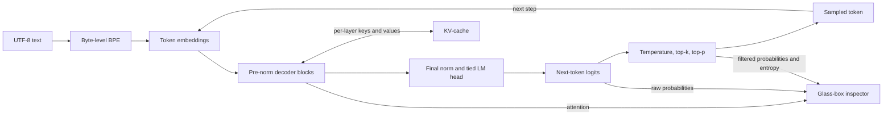
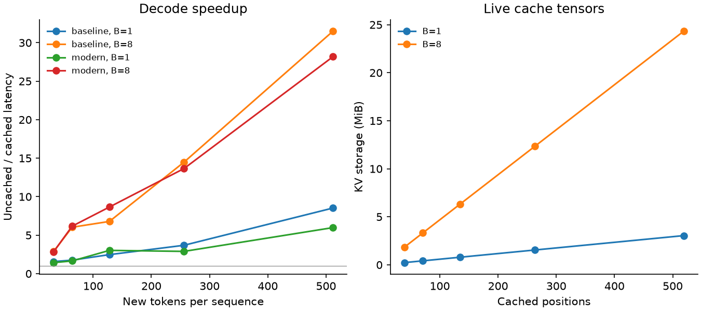

# MiniGPT

MiniGPT is a decoder-only language model built by hand in PyTorch and trained on TinyShakespeare. Start with a line of dialogue, stream a continuation, and select a token to see which alternatives survived sampling and which context positions the decoder attended to. The same model and sampler power the command line and the web inspector.



Baseline uses LayerNorm, learned positions and GELU. Modern uses RMSNorm, rotary positions and SwiGLU. Each setting can also be changed independently. The decoder implements masked attention directly and exposes its pre-dropout weights. [Implementation and interview notes](docs/design_notes.md)

## Install and serve

Run commands from the repository root. On Windows PowerShell, create and activate the project environment. On Linux or macOS, activate it with `source .venv/bin/activate`.

```powershell
python -m venv .venv
.\.venv\Scripts\Activate.ps1
python -m pip install "torch>=2.4" --index-url https://download.pytorch.org/whl/cpu
python -m pip install -e ".[dev]"
```

The CPU wheel reproduces the device choice used for the published runs. In a CUDA-enabled PyTorch environment the trainer and server select CUDA automatically. After installation, inference reads only local files.

**Data and weights.** `data/` and `checkpoints/` are outside Git. Recreate the matching tokenizer with the preparation command below. The first invocation downloads TinyShakespeare into `data/raw/input.txt`. For an offline run, add `--input path/to/input.txt` with the original UTF-8 corpus. The loader checks the tokenizer hash recorded in the checkpoint.

```sh
python scripts/prepare_data.py --vocab-size 1024 --seed 42
```

**Where to get the checkpoint.** In the completed training workspace, use `checkpoints/final.pt`. For a fresh clone, get that file from the project owner and place it there, or rebuild it locally from the tracked selection results with the following command in the CPU environment. The final trainer resumes interrupted fits and regenerates missing weights even if their metrics are already present. Training writes its outputs locally. [Recorded checkpoint and tokenizer hashes](results/final_summary.json)

```sh
python -m scripts.train_final --seed 0
```

With the checkpoint and tokenizer in place, start the server and open `http://127.0.0.1:8000/`. In PowerShell you can also set `$env:MINIGPT_CHECKPOINT = 'checkpoints/final.pt'` and omit `--checkpoint`. An explicit flag takes precedence. Use `--tokenizer` when the matching vocabulary has moved.

```sh
python -m minigpt.serve --checkpoint checkpoints/final.pt --port 8000
python -m scripts.generate --checkpoint checkpoints/final.pt --prompt "KING RICHARD:" --stream --seed 42
```

### Using the inspector

Change a sampling control and generate. Brighter chips indicate higher sampling probability. Hover, click or focus a chip to inspect its candidates. **Raw** displays the model softmax, and **Filtered** displays the distribution actually sampled after temperature and truncation. Both rank the same candidates by raw probability, show their original bytes in hex, and account separately for the mass outside the shortlist. The aligned entropy curves use nats. The live rate measures token draws including prefill, excluding network delivery and rendering.

**Token row** shows the final context position that predicted the selected token. **Prompt** shows the full causal matrix for the current prompt. Change the layer or select a head or the head mean. In the token view, a change replays the saved request with its seed. Focus the heatmap and use the arrow keys to inspect an exact query, key and weight. [Desktop capture](docs/img/glass_box_desktop.png) · [Mobile capture](docs/img/glass_box_mobile.png)

| Route | Contract |
|---|---|
| `GET /model` | Checkpoint path, configuration and architecture flags, parameter counts, tokenizer size, device and generation cap. |
| `POST /generate` | Accepts `prompt`, `temperature`, `top_k` (or null), `top_p`, `max_new_tokens`, `seed` and `use_cache`. Returns continuation text and IDs, plus tokens per second. |
| `POST /generate/stream` | One SSE `token` event per draw. Join each event’s `text` for the continuation. A partial UTF-8 character can produce an empty fragment. The last draw carries `finished`. |
| `POST /trace` | Same generation arguments, plus zero-based `layer` and `head` (an index or `"mean"`). Returns `steps` with the chosen token, top ten, omitted mass, entropies, context tokens and attention row. The stream carries the same evidence. |
| `POST /attention` | Accepts `text`, `layer` and `head`. Returns token metadata and a square matrix with query positions in rows and keys in columns. |

The API validates tokenized prompt length plus the requested continuation against the checkpoint's context window. It returns field details for invalid sampling settings and a service-unavailable response when started without a model. The CLI also supports `--window-policy reprefill` for longer sliding-window generation and `--no-cache` for comparison. [Request models and routes](minigpt/api.py) · [Generation implementation](minigpt/generate.py)

## Reproduce training, experiments and benchmarks

Prepare the study's other vocabularies using the cached raw corpus, then run the tokenizer report.

```sh
python scripts/prepare_data.py --vocab-size 512 --seed 42
python scripts/prepare_data.py --vocab-size 2048 --seed 42
python -m scripts.tokenizer_study --seed 42
```

Train the matched presets, generate their samples, and select the checkpoint for the trained-model cache check. Add `--resume` to a training command to restore its optimizer, step and random streams. Use `--run-name` for an independent run and `--override model.pos_encoding=rope` for a single architecture change. [Training curves and run settings](docs/training_phase2.md)

```sh
python -m scripts.train --config configs/cpu_tiny.yaml --preset baseline --seed 42
python -m scripts.train --config configs/cpu_tiny.yaml --preset modern --seed 42
python -m scripts.phase2_samples --seed 42
python -m scripts.phase2_summary --seed 42
python -m scripts.benchmark_kv_cache --seed 42
```

The benchmark resumes matching settings and checkpoint identity. To measure a newly trained checkpoint with a different file hash, add `--restart` in a reproduction copy. Experiment runs restore interrupted optimizer checkpoints and reuse completed JSON records. The aggregator reads the per-run histories to produce the tables and plots. [Timing plan](results/experiment_plan.json) · [Run records](results/runs/)

```sh
python -m scripts.run_experiments --plan-only --seed 0
python -m scripts.run_experiments --seed 0
python -m scripts.aggregate_results --seed 0
```

## Results

The controlled study used 212,992 training tokens per run. Losses below are endpoint means and sample standard deviations in nats per predicted token. Modern had the lowest architecture mean. RoPE alone accounted for most of its improvement over baseline. [Generated tables for all sweeps](docs/results_tables.md) · [Full-precision results](results/experiment_aggregate.json) · [Analysis and threats to validity](docs/analysis.md)

| Variant | Seeds | Total params | Non-embedding params | Train loss | Validation loss | Validation − train |
|---|---:|---:|---:|---:|---:|---:|
| Baseline | 3 | 558,144 | 447,552 | 4.6871 ± 0.0208 | 4.6230 ± 0.0174 | -0.0641 ± 0.0051 |
| + RMSNorm | 3 | 557,280 | 446,688 | 4.6886 ± 0.0127 | 4.6229 ± 0.0049 | -0.0656 ± 0.0103 |
| + RoPE | 3 | 545,856 | 447,552 | 4.4772 ± 0.0055 | 4.4146 ± 0.0033 | -0.0626 ± 0.0088 |
| + SwiGLU | 3 | 558,656 | 448,064 | 4.8242 ± 0.0416 | 4.7396 ± 0.0487 | -0.0846 ± 0.0125 |
| Modern | 3 | 545,504 | 447,200 | 4.4275 ± 0.0302 | 4.3831 ± 0.0203 | -0.0443 ± 0.0111 |

### Tokenizer study

At vocabulary size 1,024, the tokenizer encoded the validation split in 49,411 tokens at 2.2573 bytes/token. The English probe reached 2.4090 bytes/token, while the Bengali and Hindi probes each used one token per UTF-8 byte. Larger vocabularies lowered the measured language-model cost per validation byte, while increasing embedding capacity and raw-text exposure at a fixed training-token budget. [Tokenizer study](docs/tokenizer_study.md) · [Compression measurements](results/tokenizer_study.json) · [Model comparison](results/experiment_aggregate.json)

| Variant | Seeds | Total params | Non-embedding params | Validation bits/byte |
|---|---:|---:|---:|---:|
| vocab 512 | 2 | 508,992 | 447,552 | 3.1099 ± 0.0134 |
| vocab 1024 | 2 | 558,144 | 447,552 | 2.9490 ± 0.0081 |
| vocab 2048 | 2 | 656,448 | 447,552 | 2.8314 ± 0.0130 |

### KV-cache benchmark

The figure shows measured CPU speedup and live key/value storage for both presets. Timings include prompt prefill and all draws. Each storage measurement agreed with the prediction from layer count, cached length, batch, width and element size. The benchmark used random weights for timing and the earlier trained checkpoint for greedy-output agreement. [Trial data and machine settings](results/kv_cache_benchmark.json) · [Benchmark methodology](docs/kv_cache_benchmark.md)



## Final model

The published modern checkpoint has 5,024,576 parameters. Each fit below used 3,145,728 training tokens and represents a single seed. Values are truncated from the checkpoint summary. [Final model and earlier comparison](results/final_summary.json)

| Checkpoint | Validation loss (nats/token) | Validation bits/byte |
|---|---:|---:|
| Phase 2 best | 3.3270 | 2.1262 |
| Final | 3.3017 | 2.1101 |

The validation-loss gap is within the range of seed-to-seed standard deviations seen in the experiments. For context, it exceeds the modern architecture cell’s SD of 0.0203 and falls below the depth ablation’s two-layer SD of 0.0888. Neither trained checkpoint has a measured SD of its own. The single-seed comparison leaves the reliability of the difference open. [Checkpoint comparison](results/final_summary.json) · [Seed variation](docs/results_tables.md) · [Unedited samples](docs/samples_final.md)

## Tests and packaging

```sh
python -m ruff check .
python -m pytest
python scripts/smoke.py --checkpoint checkpoints/final.pt --seed 42
```

The smoke script starts a private loopback server, checks its routes and payloads, then stops it. Its server log goes to `logs/`. On Windows, run `.\.venv\Scripts\python.exe scripts/smoke.py` directly. The PowerShell task wrapper supports `.\scripts\tasks.ps1 lint`, `.\scripts\tasks.ps1 test` and the other build targets. The Makefile exposes `install`, `lint`, `test`, `data`, `train`, `experiments`, `benchmark`, `serve`, `smoke`, `docker-build` and `docker-run`. CI runs the fast suite using temporary fixtures.

For Docker, run the following commands from the repository root after preparing the tokenizer and weights. The CPU image runs as an unprivileged user. Mount both directories read-only so the saved tokenizer path resolves inside the container.

```sh
make docker-build
make docker-run
```

PowerShell equivalents are `.\scripts\tasks.ps1 docker-build` and `.\scripts\tasks.ps1 docker-run`. The browser address is the same as for the local server.

## Limitations

TinyShakespeare supplies both the contiguous training text and held-out validation suffix. The same validation split informed model selection and reporting. Short-budget architecture rankings can depend on optimizer settings, text exposure and time to convergence. Attention weights describe how a head mixes its value vectors. They alone cannot establish why a word was chosen. [Experiment interpretation](docs/analysis.md) · [Attention implementation](minigpt/model.py)

## What I'd do next

Repeat the checkpoint comparison at matched seeds and evaluate on a holdout reserved before tuning. For the tokenizer comparison, match raw-byte exposure as well as compute. In the inspector, compare a token’s probability before and after masking a selected context position to test whether a visually prominent attention weight predicts a meaningful change.
