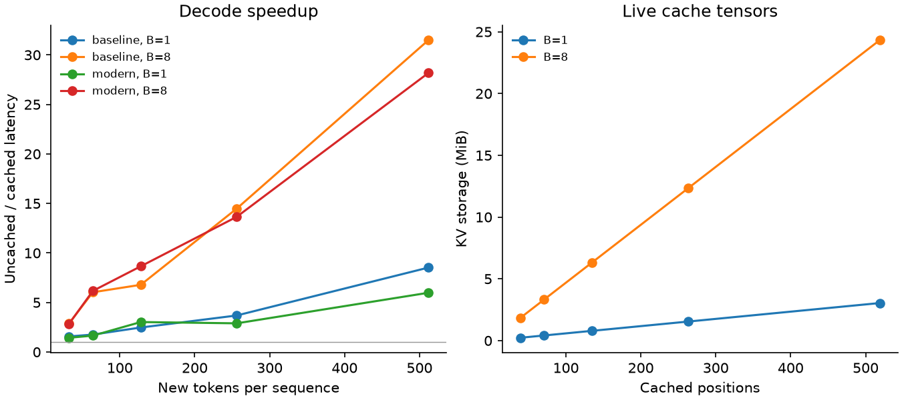

# KV-cache benchmark

Random cpu_tiny weights, context capacity 1024, 8 prompt tokens, device cpu. Each median covers 3 timed greedy generations after warmup. Latency includes prefill and all draws. Throughput counts new tokens across the batch. [Trials and machine details](../results/kv_cache_benchmark.json)

| Preset | Batch | New tokens | Plain s | Cached s | Plain tok/s | Cached tok/s | Speedup | Cached positions | Storage bytes | Formula bytes |
|---|---:|---:|---:|---:|---:|---:|---:|---:|---:|---:|
| baseline | 1 | 32 | 0.1049 | 0.0668 | 304.8 | 478.6 | 1.570× | 39 | 239616 | 239616 |
| baseline | 1 | 64 | 0.2469 | 0.1405 | 259.1 | 455.4 | 1.757× | 71 | 436224 | 436224 |
| baseline | 1 | 128 | 0.6797 | 0.2749 | 188.3 | 465.5 | 2.472× | 135 | 829440 | 829440 |
| baseline | 1 | 256 | 2.5579 | 0.6939 | 100.0 | 368.9 | 3.686× | 263 | 1615872 | 1615872 |
| baseline | 1 | 512 | 12.7705 | 1.4977 | 40.0 | 341.8 | 8.526× | 519 | 3188736 | 3188736 |
| baseline | 8 | 32 | 0.2839 | 0.0991 | 901.4 | 2582.1 | 2.864× | 39 | 1916928 | 1916928 |
| baseline | 8 | 64 | 1.2029 | 0.1994 | 425.6 | 2567.1 | 6.031× | 71 | 3489792 | 3489792 |
| baseline | 8 | 128 | 4.4535 | 0.6563 | 229.9 | 1560.1 | 6.785× | 135 | 6635520 | 6635520 |
| baseline | 8 | 256 | 18.8786 | 1.3039 | 108.4 | 1570.5 | 14.477× | 263 | 12926976 | 12926976 |
| baseline | 8 | 512 | 102.0840 | 3.2407 | 40.1 | 1263.8 | 31.499× | 519 | 25509888 | 25509888 |
| modern | 1 | 32 | 0.1544 | 0.1076 | 207.1 | 297.2 | 1.434× | 39 | 239616 | 239616 |
| modern | 1 | 64 | 0.3871 | 0.2344 | 165.3 | 272.9 | 1.650× | 71 | 436224 | 436224 |
| modern | 1 | 128 | 1.3480 | 0.4456 | 94.9 | 287.2 | 3.024× | 135 | 829440 | 829440 |
| modern | 1 | 256 | 3.8978 | 1.3469 | 65.6 | 190.0 | 2.893× | 263 | 1615872 | 1615872 |
| modern | 1 | 512 | 14.6961 | 2.4564 | 34.8 | 208.4 | 5.982× | 519 | 3188736 | 3188736 |
| modern | 8 | 32 | 0.3918 | 0.1386 | 653.2 | 1846.2 | 2.826× | 39 | 1916928 | 1916928 |
| modern | 8 | 64 | 1.7602 | 0.2853 | 290.8 | 1794.2 | 6.168× | 71 | 3489792 | 3489792 |
| modern | 8 | 128 | 5.3598 | 0.6192 | 191.0 | 1653.7 | 8.655× | 135 | 6635520 | 6635520 |
| modern | 8 | 256 | 21.6564 | 1.5867 | 94.5 | 1290.6 | 13.648× | 263 | 12926976 | 12926976 |
| modern | 8 | 512 | 112.3397 | 3.9858 | 36.4 | 1027.6 | 28.184× | 519 | 25509888 | 25509888 |

The smallest observed speedup was 1.434× (modern, batch 1, 32 new tokens). The largest was 31.499× (baseline, batch 8, 512 new tokens). Short continuations amortize prefill and per-step cache handling over fewer saved prefix computations.

Storage counts unique live K and V tensor buffers after the last draw. The final sampled token has yet to enter the model. The prediction in bytes is `2 × layers × batch × cached positions × embedding width × bytes per element`. The largest absolute discrepancy was 0 bytes. Temporary attention matrices and allocator reserves are outside this measurement.

## Context limits

The default policy checks prompt plus requested continuation against block_size. With reprefill, a full cache is discarded. The last block_size−1 preceding tokens and the newest token are evaluated together again, matching uncached sliding windows. For learned position embeddings, surviving tokens need new positions starting at zero. Deeper cached states also contain information from evicted history, including with RoPE. Exact re-prefill costs quadratic attention work per step once full.

The trained checkpoint also produced identical cached and uncached greedy continuations at the lengths recorded in the benchmark JSON.
