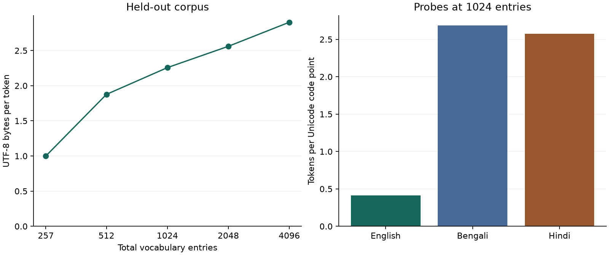

# Byte-level BPE on held-out text

Each vocabulary was fitted independently on the first 1,003,854 UTF-8 bytes of the corpus. The contiguous suffix contains 111,540 bytes. Training time measures only the tokenizer fit on this machine.

Compression is the baseline token count divided by the fitted tokenizer’s count. It measures sequence length. Ratios are truncated for display. Elapsed seconds are converted directly from the recorded nanoseconds.

| Vocabulary | Validation tokens | Bytes/token | Compression vs. bytes | Fit time (s) |
|---:|---:|---:|---:|---:|
| 257 | 111,540 | 1.0000 | 1.0000× | 0.000128100 |
| 512 | 59,436 | 1.8766 | 1.8766× | 1.588781000 |
| 1024 | 49,411 | 2.2573 | 2.2573× | 1.332787200 |
| 2048 | 43,563 | 2.5604 | 2.5604× | 2.223551500 |
| 4096 | 38,424 | 2.9028 | 2.9028× | 1.847778600 |

## Multilingual probe

The 1024-entry tokenizer encoded short descriptions of the same scene. Characters are Unicode code points, including spaces, punctuation and combining marks.

| Language | Bytes | Characters | Tokens | Bytes/token | Tokens/character |
|---|---:|---:|---:|---:|---:|
| English | 159 | 159 | 66 | 2.4090 | 0.4150 |
| Bengali | 408 | 152 | 408 | 1.0000 | 2.6842 |
| Hindi | 402 | 156 | 402 | 1.0000 | 2.5769 |

## Interpretation

Validation tokens saved per added vocabulary entry fell from 204.3294 over the first interval to 2.5092 over the last. Each added entry costs another embedding row at fixed model width. On this small corpus, the compression gain must justify that additional capacity. Per code point, the Bengali passage used 6.4665× as many tokens as the English passage and the Hindi passage used 6.2080×. These ratios describe the three passages at the measured vocabulary size.

### Probe texts

**English**  
Rain tapped on the kitchen window. I put the kettle on and watched a sparrow shelter under the sill. When the clouds cleared, it shook its wings and flew away.

**Bengali**  
রান্নাঘরের জানালায় বৃষ্টির ফোঁটা পড়ছিল। আমি চায়ের জল বসিয়ে দেখলাম, একটি চড়ুই জানালার নিচে আশ্রয় নিয়েছে। মেঘ কেটে গেলে পাখিটি ডানা ঝেড়ে উড়ে গেল।

**Hindi**  
रसोई की खिड़की पर बारिश की बूँदें गिर रही थीं। मैंने चाय का पानी चढ़ाया और देखा कि एक गौरैया खिड़की के नीचे दुबकी हुई थी। बादल छँटे तो वह पंख झाड़कर उड़ गई।
