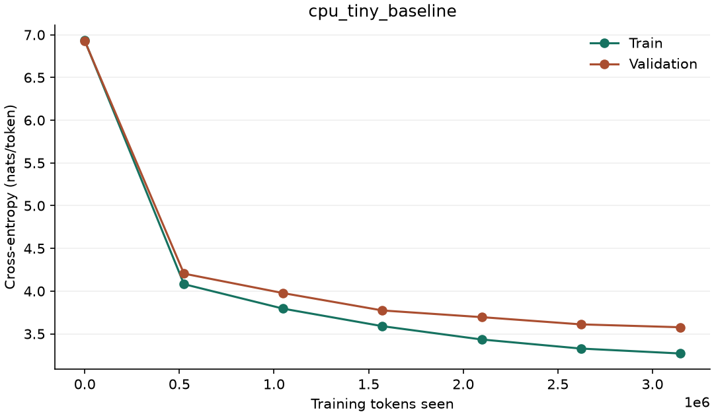
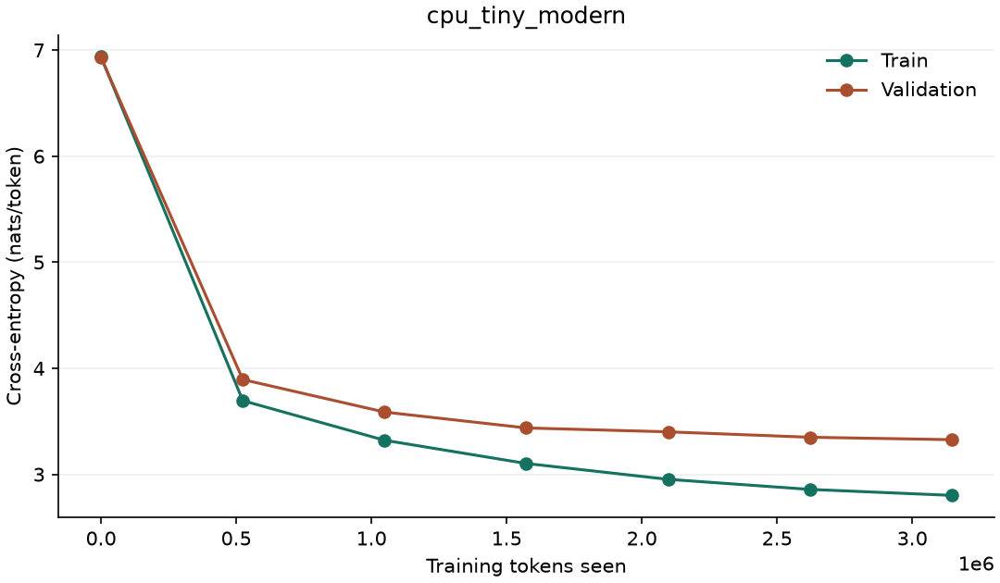

# Baseline and modern MiniGPT on TinyShakespeare

Both fits used seed 42 and scored 3,145,728 training targets in 3,072 optimizer updates each. Both curves use full train and validation sweeps with dropout disabled. Each next-token target is scored once, including the final partial window.

The uniform reference scored 6.9314 nats/token. The empirical train unigram scored 5.7085 on the same 49,410 validation targets. Gaps below are validation loss minus training loss. Elapsed minutes include the evaluations. [Machine-readable comparison](../results/phase2_summary.json)

| Preset | Best step | Train loss there | Best val loss | Val PPL | Val BPB | Final gap | Elapsed min |
|---|---:|---:|---:|---:|---:|---:|---:|
| baseline | 3,072 | 3.2700 | 3.5770 | 35.7691 | 2.2861 | 0.3070 | 21.1492 |
| modern | 3,072 | 2.8019 | 3.3270 | 27.8550 | 2.1262 | 0.5250 | 22.2924 |

The modern checkpoint had the lower measured validation loss by 0.2500 nats/token. Selection used the minimum across recorded evaluations for each run. [Matched temperature samples](samples_phase2.md)

## Learning curves

### Baseline

At the final step, training loss was 3.2700 and validation loss was 3.5770. Training loss fell while validation loss rose in 0 measured intervals. [Full curve data](../results/runs/cpu_tiny_baseline/metrics.csv)



### Modern

At the final step, training loss was 2.8019 and validation loss was 3.3270. Training loss fell while validation loss rose in 0 measured intervals. [Full curve data](../results/runs/cpu_tiny_modern/metrics.csv)



## Parameter counts

| Configuration | Baseline | Modern |
|---|---:|---:|
| cpu_tiny | 2,001,024 | 1,975,744 |
| gpu_small | 18,236,928 | 18,135,680 |

## Reproduce from the project environment

```sh
python scripts/train.py --config configs/cpu_tiny.yaml --preset baseline --seed 42
python scripts/train.py --config configs/cpu_tiny.yaml --preset modern --seed 42
```

Add `--resume` to continue the matching run from its last saved update.
